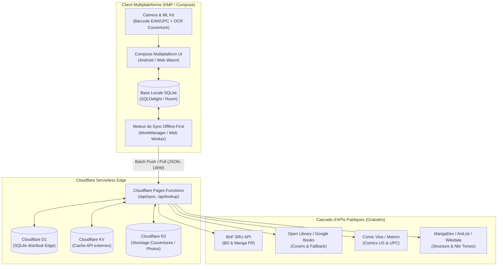

# Architecture & Proposition Technique — Projet Bullix

Ce document détaille la proposition technique, les choix d'architecture logicielle, les flux de données et la stratégie d'implémentation pour l'application **Bullix**, conçue pour les collectionneurs de bandes dessinées (Franco-belge, Mangas, Comics).

---

## 1. Vision & Objectifs Métier

Bullix résout les trois frustrations majeures rencontrées sur le terrain par les collectionneurs :

1. **Rangement & Localisation physique ultra-précise** :
   - Arborescence visuelle : *Salon › Bibliothèque Est › Étagère 2 › Casier 12*.
   - Identification physique des casiers par **QR Codes** scannables.
   - Modes rapides : Saisie par lot ("Range-tout") et mode "Audit / Inventaire d'étagère".
2. **Anti-Doublon instantané en brocante / convention ("Offline-First")** :
   - 100 % opérationnel sans 4G/5G ni Wi-Fi (caves, hangars, vide-greniers reculés).
   - Réponse en moins de 100 ms : « Album déjà possédé ? Oui/Non », avec état d'usure et casier associé.
3. **Complétion intelligente des séries** :
   - Détection automatique du statut de la série (en cours, terminée, abandonnée).
   - Tableau de bord des tomes manquants (« *Voir les suites* »).

---

## 2. Architecture Globale du Système

Bullix capitalise sur le socle éprouvé du projet **Needix** (Kotlin Multiplatform + Cloudflare Edge Serverless).



---

## 3. Stratégie de Capture & Pipeline d'Identification

L'identification combine deux couches complémentaires : **On-Device (100 % hors-ligne)** et **Edge Resolution (en ligne avec mise en cache)**.

### 3.1. Pipeline Hors-Ligne (On-Device)
- **Code-barres (EAN-13 / UPC-A)** : Scan via Google ML Kit Barcode Scanning.
  - Recherche prioritaire dans la base locale SQLite : si l'album ou l'EAN existe déjà, le statut de possession s'affiche immédiatement (< 50 ms).
- **OCR de Couverture (Sans code-barres / Éditions anciennes)** :
  - Extraction de texte par ML Kit Text Recognition sur l'appareil.
  - Algorithme de nettoyage textuel local :
    1. Extraction et conversion des numéros de tomes (chiffres arabes, romains `Tome IV`, `#12`).
    2. Filtrage du bruit typographique (mentions légales, logos éditeurs, prix en Francs/Euros).
    3. Normalisation (retrait des accents, mise en minuscules pour comparaison floue).
  - Recherche floue (Levenshtein / Trigrammes) dans les titres de séries de la base locale.

### 3.2. Cascade d'APIs et Résolution Edge

Lorsque le réseau est disponible, les recherches non résolues localement interrogent le backend Cloudflare qui orchestre la cascade :

| Priorité | Cible | Source | Rôle & Format | Quotas & Stratégie |
| :--- | :--- | :--- | :--- | :--- |
| **1** | BD & Manga FR | **BnF (API SRU)** | Référence officielle ISBN/EAN, titre, auteurs, éditeur (MarcXML / Dublin Core) | Gratuit, illimité, respectueux |
| **2** | Couvertures & Secours | **Open Library & Google Books** | Récupération des URLs de jaquettes et résolution secondaire | Cache KV 30 jours, R2 pour les assets |
| **3** | Comics US | **Comic Vine / Metron** | Résolution des codes UPC 5 chiffres, numéros de fascicules | API Key gratuite, mise en cache stricte |
| **4** | Structure Séries | **MangaDex / AniList / Wikidata** | Nombre total de volumes parus, statut ("En cours" / "Terminée") | Interrogation ponctuelle à l'ajout |

---

## 4. Modèle de Données Relationnel (Cloudflare D1 & SQLite)

Le schéma dissocie le **catalogue universel** (référentiel des séries et albums) des **données physiques de l'utilisateur** (emplacements, possession, état), tout en intégrant la table de journalisation de synchronisation.

```sql
-- ============================================================================
-- 1. SÉRIES & ALBUMS (Référentiel Universel)
-- ============================================================================

CREATE TABLE IF NOT EXISTS series (
    id TEXT PRIMARY KEY NOT NULL,          -- UUIDv4 ou slug universel
    title TEXT NOT NULL,
    type TEXT CHECK(type IN ('Franco-belge', 'Manga', 'Comics', 'Autre')),
    status TEXT CHECK(status IN ('En cours', 'Terminée', 'Abandonnée', 'Inconnue')),
    total_volumes INTEGER DEFAULT NULL,
    publisher_default TEXT,
    created_at INTEGER NOT NULL,           -- Timestamp Unix (ms)
    updated_at INTEGER NOT NULL,
    deleted_at INTEGER DEFAULT NULL
);

CREATE INDEX IF NOT EXISTS idx_series_title ON series(title);

CREATE TABLE IF NOT EXISTS albums (
    id TEXT PRIMARY KEY NOT NULL,          -- UUIDv4
    series_id TEXT NOT NULL,
    volume_number REAL NOT NULL,           -- Supporte les tomes spéciaux (ex: 0, 1.5)
    title TEXT,
    isbn TEXT,                             -- EAN-13 / ISBN-10 (Indexé)
    upc TEXT,                              -- UPC Comics US
    authors TEXT,                          -- Format JSON ou CSV dénormalisé
    publisher TEXT,
    published_year INTEGER,
    cover_image_url TEXT,
    created_at INTEGER NOT NULL,
    updated_at INTEGER NOT NULL,
    deleted_at INTEGER DEFAULT NULL,
    FOREIGN KEY (series_id) REFERENCES series(id) ON DELETE CASCADE
);

CREATE INDEX IF NOT EXISTS idx_albums_isbn ON albums(isbn);
CREATE INDEX IF NOT EXISTS idx_albums_series_id ON albums(series_id, volume_number);

-- ============================================================================
-- 2. LOCALISATIONS & COLLECTION UTILISATEUR
-- ============================================================================

CREATE TABLE IF NOT EXISTS locations (
    id TEXT PRIMARY KEY NOT NULL,
    user_id TEXT NOT NULL,
    name TEXT NOT NULL,                    -- Ex: "Salon › Bibliothèque Est › Casier 12"
    qr_code_ref TEXT UNIQUE,              -- Valeur encodée dans le QR physique
    color_tag TEXT,                        -- Repère visuel dans l'interface
    created_at INTEGER NOT NULL,
    updated_at INTEGER NOT NULL,
    deleted_at INTEGER DEFAULT NULL
);

CREATE INDEX IF NOT EXISTS idx_locations_user ON locations(user_id);
CREATE INDEX IF NOT EXISTS idx_locations_qr ON locations(qr_code_ref);

CREATE TABLE IF NOT EXISTS user_collection (
    id TEXT PRIMARY KEY NOT NULL,          -- UUIDv4
    user_id TEXT NOT NULL,
    album_id TEXT NOT NULL,
    location_id TEXT,                      -- NULL = en attente de rangement
    condition TEXT CHECK(condition IN ('Neuf', 'Très bon', 'Bon', 'Passable', 'Mauvais', 'Lu')),
    edition_info TEXT,                     -- Ex: "Édition originale", "Tirage limité n°42"
    purchase_price REAL,
    purchase_date TEXT,
    notes TEXT,
    is_favorite INTEGER DEFAULT 0,
    created_at INTEGER NOT NULL,
    updated_at INTEGER NOT NULL,
    deleted_at INTEGER DEFAULT NULL,
    FOREIGN KEY (album_id) REFERENCES albums(id),
    FOREIGN KEY (location_id) REFERENCES locations(id)
);

CREATE INDEX IF NOT EXISTS idx_user_collection_user ON user_collection(user_id);
CREATE INDEX IF NOT EXISTS idx_user_collection_album ON user_collection(album_id);
CREATE INDEX IF NOT EXISTS idx_user_collection_location ON user_collection(location_id);

-- ============================================================================
-- 3. JOURNAL DE SYNCHRONISATION (Generic Sync Records)
-- ============================================================================

CREATE TABLE IF NOT EXISTS records (
    id TEXT PRIMARY KEY NOT NULL,          -- UUIDv4 généré côté client
    user_id TEXT NOT NULL,
    entity_type TEXT NOT NULL,             -- 'series', 'album', 'location', 'user_collection'
    payload TEXT NOT NULL,                 -- JSON complet de l'entité
    sync_status TEXT DEFAULT 'SYNCED',     -- 'SYNCED', 'PENDING_INSERT', 'PENDING_UPDATE', 'PENDING_DELETE'
    created_at INTEGER NOT NULL,
    updated_at INTEGER NOT NULL,           -- Timestamp Unix (ms)
    deleted_at INTEGER DEFAULT NULL
);

CREATE INDEX IF NOT EXISTS idx_records_updated_at ON records(updated_at);
CREATE INDEX IF NOT EXISTS idx_records_user_id ON records(user_id);
CREATE INDEX IF NOT EXISTS idx_records_entity ON records(entity_type, user_id);
```

---

## 5. Mécanique de Synchronisation Offline-First

### 5.1. Principe d'Écriture Locale Prioritaire (Optimistic UI)
1. Toute modification utilisateur (ajout, déplacement de casier, notation d'état) est enregistrée **immédiatement dans la base SQLite locale**.
2. L'interface Compose réagit instantanément sans blocage réseau.
3. Le champ `sync_status` local prend la valeur `PENDING_INSERT`, `PENDING_UPDATE` ou `PENDING_DELETE`, et `updated_at` reçoit l'horodatage courant `System.currentTimeMillis()`.

### 5.2. Cycle de Push (Envoi en Lot)
- **Déclenchement** : Automatique lors de la reconnexion réseau (via `WorkManager` sous Android ou `navigator.onLine` sous Wasm Web), ou déclenchement manuel lors du pull-to-refresh.
- **Payload** : Envoi d'un lot (`batch`) de mutations au format JSON vers `POST /api/sync/push`.
- **Résolution de conflits côté Edge (Last-Write-Wins)** :
  - L'API Cloudflare compare le `updated_at` entrant avec le `updated_at` présent dans D1.
  - L'enregistrement le plus récent l'emporte.
- **Accusé de réception (ACK)** : L'API renvoie la liste des identifiants confirmés ; le worker local met à jour leur statut en `SYNCED`.

### 5.3. Cycle de Pull (Récupération des Deltas)
- Le client appelle `GET /api/sync/pull?since={last_sync_timestamp}`.
- Cloudflare D1 extrait les enregistrements modifiés ou supprimés (`deleted_at IS NOT NULL`) depuis cet horodatage.
- Le client met à jour sa base locale et avance son curseur `last_sync_timestamp`.

---

## 6. Stack Technique & Découpage Modulaire

```
Bullix/
├── shared/                         # Logique commune KMP
│   ├── commonMain/
│   │   ├── kotlin/fr/bullix/
│   │   │   ├── domain/             # Modèles métier & UseCases
│   │   │   ├── data/               # Repositories, SQLDelight DB
│   │   │   ├── sync/               # SyncEngine, DeltaTracker, LWW
│   │   │   ├── api/                # Clients BnF, OpenLib, Cloudflare API
│   │   │   └── ui/                 # Composants d'interface Compose Multiplatform
│   │   └── sqldelight/             # Définitions de tables et requêtes SQLDelight
│   ├── androidMain/                # Implémentations CameraX, ML Kit Barcode & OCR
│   └── wasmJsMain/                 # Implémentations Web BarcodeDetector, Storage
├── androidApp/                     # Application Android native (Hilt/Koin, WorkManager)
├── wasmApp/                        # Application Web Wasm déployée sur Cloudflare Pages
├── functions/                      # Cloudflare Pages Functions (Edge API TypeScript)
│   ├── api/
│   │   ├── sync/
│   │   │   ├── push.ts             # Traitement batch & LWW D1
│   │   │   └── pull.ts             # Récupération delta D1
│   │   └── lookup/
│   │       ├── isbn.ts             # Résolution EAN avec cache KV & BnF
│   │       └── ocr.ts              # Recherche textuelle intelligente
├── wrangler.toml                   # Configuration Cloudflare (D1, KV, R2)
└── schema.sql                      # Schéma SQL initial pour D1
```

---

## 7. Plan de Déploiement & Roadmap

1. **Jalon 1 — Socle Core & Local-First (Semaine 1-2)**
   - Initialisation du projet KMP (Compose Multiplatform Android + Web Wasm).
   - Schéma SQLDelight local et tables métier (`series`, `albums`, `locations`, `user_collection`).
   - Écran de collection, navigation par casiers et fiche album.
2. **Jalon 2 — Moteur de Scan & Cascade d'APIs (Semaine 3-4)**
   - Intégration ML Kit Barcode Scanning (EAN-13).
   - Intégration ML Kit Text Recognition pour l'OCR de couverture avec algorithme de nettoyage de titre.
   - Module Cloudflare Pages Functions pour la résolution BnF + Open Library avec mise en cache Cloudflare KV.
3. **Jalon 3 — Synchronisation Cloudflare D1 & Mode Web (Semaine 5-6)**
   - Mise en place du `SyncEngine` bidirectionnel avec `WorkManager`.
   - Endpoints `/api/sync/push` et `/api/sync/pull` sur Cloudflare Pages.
   - Build et déploiement continu du client Web Wasm sur Cloudflare Pages.
4. **Jalon 4 — QR Codes & Complétion des Séries (Semaine 7)**
   - Génération et impression d'étiquettes QR Code pour les casiers.
   - Algorithme de détection des tomes manquants (« *Voir les suites* »).
